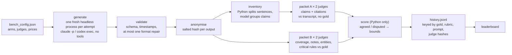

# Evaluation

Two questions, measured separately:

1. **Which model should extract a session?** An extraction is a recap plus entity records
   from one transcript. Measured against one human-approved gold reference (E1).
2. **Are the synthesized knowledge-base sentences true to the recording?** Measured per
   sentence against the transcript window its citation points at (B3, E3).

Results live next to this page, written by the tools, with the command that reproduces
each number:

| File | Written by | State |
|---|---|---|
| `extraction.md` | `extraction_benchmark.py leaderboard --out ../../docs/benchmarks/extraction.md` | after the first graded run |
| `synthesis.md` | `bench_launch.py claims-report --claims tests/data/claims/2026-10-26-1234.yaml --out ../../docs/benchmarks/synthesis.md` | after the first judged claim file |

Both commands run from `services/kb`. Transcripts, gold and model outputs are private
(campaign data); the tables carry only labels, scores, costs and the hashes that pin the
inputs. The synthesis claim sample is committed (speaker labels scrubbed), so its numbers
can be re-derived from this repository alone.

## How a run works



- **Subscriptions, not API keys.** Every model call is a fresh `claude -p` or `codex exec`
  process on the owner's subscription login (`services/kb/bench_launch.py`). The launcher
  aborts if an API key is set, refuses to run inside an agent session, rejects a reply
  that Claude Code answered with a different model than requested, and rejects any Codex
  reply that used a tool.
- **Blind judges from two families.** Judges (Claude Opus and Codex Sol) get the transcript,
  the anonymous output and, for packet B, the gold, all inlined. They never see which model
  made the output. Two families, so a judge grading its own family is visible: the tables
  show F per judge.
- **Python does the arithmetic.** Judges only give verdicts per item. Agreement resolves an
  item; disagreement leaves it open and the score becomes a range (`71.2–74.0`). No average
  of opposite verdicts.
- **Official needs a human twice.** A score is `official` only when the gold is approved by
  hash in a human's own terminal and every judge has passed calibration against blind
  human labels (≥ 90 % agreement overall, ≥ 85 % on factual claims, no critical miss).
  Everything else is `provisional` and says why.
- **Cost is a separate column.** API-equivalent dollars from recorded token usage × a
  dated price table; unknown is `unknown`, never 0. Quality and cost are never folded into
  one number.
- **Comparable or not at all.** Each results table pins gold, rubric, prompt, judges and
  inventory by hash. A changed judge prompt starts a new table instead of silently shifting
  old numbers. ▲/▼ mark a move outside the previous run's bounds; that is a bounds check,
  not a significance test.

Q (0–100) = 0.35 F (claims supported) + 0.20 C (gold facts covered) + 0.20 N (facts in the
right entity's note) + 0.15 E (entity identity and type) + 0.10 G (citation within ±2
segments). Packet A alone yields F and G and needs no gold; that is the first number a new
model gets. Full procedure and gates: [EXTRACTION-BENCHMARK.md](../EXTRACTION-BENCHMARK.md).

## Synthesis faithfulness

The B3 sampler draws 60 sentences from the synthesized bundle, stratified by type and
tier, each with the ±90 s transcript window around its citation. Both judges label every
sentence (`supported`, `misattributed`, `claimed_not_observed`, `unsupported`, `unclear`); a
human labels every third sentence before reading any judge file. The report gives the
supported rate per labeller and agreement as raw rate and Cohen's kappa. Kappa matters
here because `supported` dominates, and a judge that always says `supported` still agrees
with a human most of the time.

## Manual and scheduled runs

```powershell
cd services/kb
# a new model or a re-check: add or pick an arm in bench_config.json, then
.venv/Scripts/python.exe bench_launch.py run --arms <label>[,<label>]
# grade outputs that already exist (packet A needs no gold)
.venv/Scripts/python.exe bench_launch.py grade --run <run> --packets A
```

Exit 75 means a subscription hit its usage limit; the same command resumes after the reset.
The scheduled task (procedure §12) runs `bench_launch.py run` daily; the run id is the ISO
week, so the week's run is resumed until done and costs nothing after.

## Limits

- One gold case (one session, ~5,000 words). Repeats measure sampling noise on this case,
  not generalisation across sessions.
- Host CLIs add their own system prompt; temperature is not controllable; Claude and OpenAI
  effort levels are not equivalent.
- API-equivalent cost is a proxy, not the subscription bill or quota.
- The claim inventory is made by one model family for every output; a stated limit, not
  corrected for.
- Extraction quality says nothing about synthesis quality, and the claim judge's ±90 s
  window can miss evidence for sentences that draw on several sessions.
